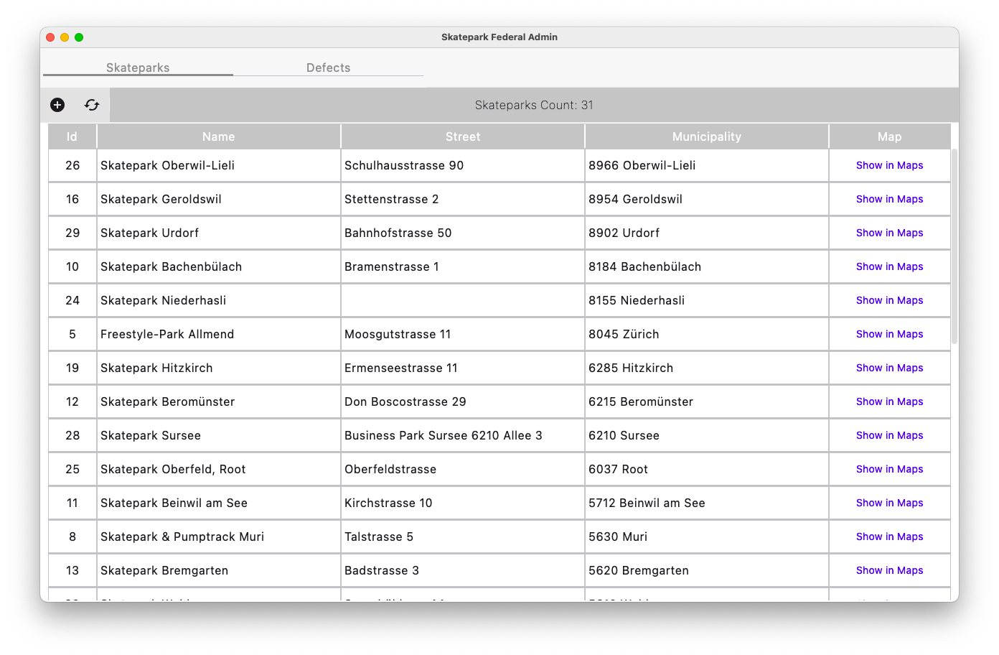
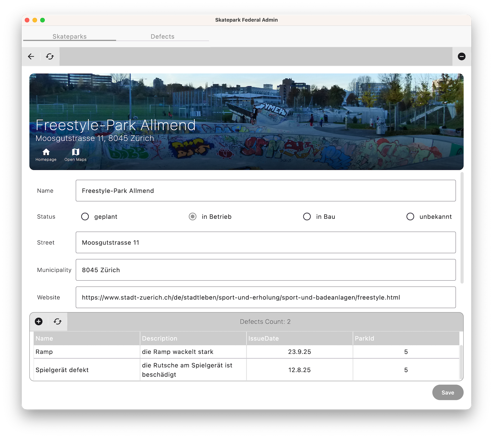
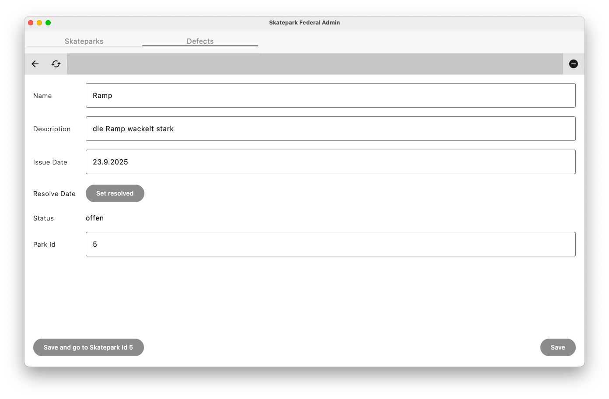

== edea Assignment 2 : SkateParks V2

=== Bearbeitet von

* _Ben Böhler_

=== Abgabe

* Dienstag, 3.11.2026, 15:00 Uhr

Die Abgabe erfolgt durch einen `Push` auf den `main`-Branch Ihres GitHub-Repositories.

=== Initiale Schritte
[circle]
* Tragen Sie ihren Namen unter "Bearbeitet von" ein.
* Pushen Sie diese Änderung am besten sofort ins Git-Repository (z.B. via `Git -> Commit… -> Commit&Push`)

=== Die Aufgabe: Desktop Applikation für die Verwaltung von SkateParks

In diesem Assigment soll die Applikation zur Verwaltung von Skateparks aus Assignment 1 erweitert werden. Es soll nun möglich sein, Schadensmeldungen (sogenannte Defects) zu erfassen und zu verwalten. Die Mängel (Defects) haben ein Erstelldatum und ein Datum, wann der Mangel behoben wurde (resolvedDate). Ein Status offen/inBearbeitung/erledigt gehört hier dazu.

Diese Applikation hilft Mitarbeitenden des Bundes bei der Verwaltung der in der Schweiz vorhandenen/geplanten Skateparks und bei der Koordination der Wartung und Pflege der SkateParks.

Im Projekt enthalten ist ein umfangreicher "Starter-Code". Diesen gilt es zu vervollständigen, so dass eine Applikation mit zwei Tabs und jeweils einem Drill-Down-UI für Skateparks und Defects entsteht.

Es bestehen bereits zwei Tabs zum Wechsel zwischen den Skateparks und den Defects. Für beide Entitäten soll zuerst der Explorer angezeigt und beim Anklicken eines Items dann der jeweilige Editor.

Daraus ergeben sich also sieben Teile der Applikation: Defects-Explorer, -Editor und -Admin, Skateparks-Explorer, -Editor und -Admin und Fed-Admin. Alle Teile sollen einzeln startbar sein. Der FedAdmin ist die eigentliche Hauptapplikation.

Besonderheit: Im Skatepark Editor sieht man eine Tabelle der zugehörigen Defects, also ein erneuter DefectsExporer, der nur die Defects des aktuellen Skateparks auflistet. Klickt man dort einen Defect an, gelangt man auf den Defectseditor. Auch ein neuer Defect kann vom Skatepark Editor aus angelegt werden.

Diese Bilder zeigen lediglich _eine_ mögliche Lösung (inkl. weiterer Features). Ihre Applikation muss nicht exakt so aussehen.

In `SharedComposables` sind wiederverwendbare Composable Functions enthalten. Es wird empfohlen diese zu verwenden.

=== Anforderungen
[circle]
* Gewünschte Funktionalität
** Darstellung aller Schweizer SkateParks und aller Defects (jeweils mit einem "Explorer")
*** Skatepark-Explorer zeigt mindestens die Werte  'id', 'name', 'street' und 'municipality'.
*** Defect-Explorer zeigt mindestens die Werte  'name', 'description', 'issuedate', 'parkId'.
** Editoren zur Veränderung eines `SkateParks` und eines `Defects`
*** Skatepark-Editor
**** Der Skatepark-Header zeigt mindestens die Werte 'name', 'street' und 'municipality' als Read-Only-Felder.
**** Das Formular besteht mindestens aus editierbaren Feldern für 'status', 'name', 'street', 'municipality', 'website' und 'imageurl'.
*** Defect-Editor
**** Der Defect-Editor muss keinen Header haben.
**** Das Formular im Defect-Editor besteht aus editierbaren Feldern für alle Werte. Interaction-Design Überlegungen zu Status des Defects und ResolvedDate und dazu passendes UI/UX sind Teil der Aufgabe.
** Drill-Down-Views für Skateparks sowie Defects
*** Selektion eines Eintrags im Explorer führt zur Anzeige des selektierten Eintrags im Editor
*** Es ist immer nur entweder der Explorer oder der Editor sichtbar
*** Im Editor führen die Aktionen "Save" und "Back" zurück zum Explorer. Bei einem "Save" werden die Daten in der Datenbank gespeichert und der Explorer zeigt die geänderten Daten an.
** neue Einträge können angelegt werden ("Create")
** bestehende Einträge können gelöscht werden ("Delete")
** Einträge können modifiziert werden ("Save")

** Die sieben Teile SkateparkExplorer, SkateparkEditor, SkateparkAdmin, DefectsExplorer, DefectsEditor, DefectsAdmin, FedAdmin können einzeln gestartet werden.

* Architektur
** klare Aufgabenverteilung zwischen Model, View und Controller
** Verwendung der Konzepte "Attribut", "Action", "FormModel" wie im Untericht besprochen
** Die Implementierungssprache für die gesamte Applikation ist Kotlin
** Das UI ist mit Compose Multiplatform implementiert
** Keine Verwendung von Libraries, die nicht bereits im Unterricht eingesetzt wurden

* TestCases
** Für alle drei Teile bestehen bereits Testcases in unterschiedlichen Ausführungen. Orientieren Sie sich an den Testcases zur Implementierung. Darin liegt die Feinspezifizierung. Bei Skateparks müssen gewisse Testcases nur einkommentiert werden und sind damit schon erledigt. Bei Defects und Fed müssen die Testcases noch implementiert werden, die Klassen sind schon da.
*** Insbesondere im `SkateparkEditorControllerTest` wird bereits ein grösserer Teil der Funktionalität von `SkateParkEditorController` abgedeckt. Im Starter-Code sind die Testcases noch auskommentiert. Ausser an den mit Todo gekennzeichneten Stellen (`fail("todo")`) ist es nicht erlaubt die Testcases zu verändern (ausser dem "einkommentieren", natürlich).

=== Bewertung
Es können in diesem Assignment maximal 25 Punkte erreicht werden. Der Fokus liegt dabei, neben der Umsetzung der gewünschten Funktionalität, auf der Code-Qualität.

[cols="4,^1,^1", format=dsv]
|===
Bereich:Mögliche Punktzahl:erreichte Punkte
*Funktionalitäten*::
Skatepark Explorer mit Controller/Actions:2:
Skatepark Editor mit Controller/Actions/FormModel/Attribute:2:
SkatePark Admin mit Controller/Actions:1:
SkatePark Implementierung vollständig anhand aller SkatePark Tests:1:
Skatepark Editor mit Defects Explorer pro Park inklusive "New Defect":3:
Defects Explorer mit Controller/Actions:1:
Defects Editor mit Controller/Actions/FormModel/Attribute:2:
Defects Editor – gutes Interaction Design für "erledigt / resolvedDate":2:
Defect Save und SaveBacktoPark:1:
Create/Delete Defect:1:
Defects Admin mit Controller/Actions:1:
FedAdmin – Controllerhierarchie über Skateparks und Defects:1:
*Architektur*::
Saubere Anwendung der Grundkonzepte aus dem Unterricht:2:
Saubere Aufteilung der Composables in Sub-Composables:1:
*Test-Cases*::
Todos in SkateparkEditorControllerTest:1:
Defects Tests:2:
FedAmin Tests:1:
*Summe*:*25*:*?*
|===

Die Note wird wie folgt berechnet und macht 40% der Gesamtnote aus.

Note = ((Erreichte Punkte / 25) * 5) + 1

Erreichte Note = __